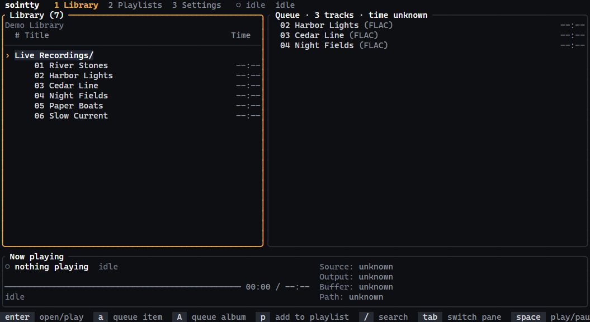
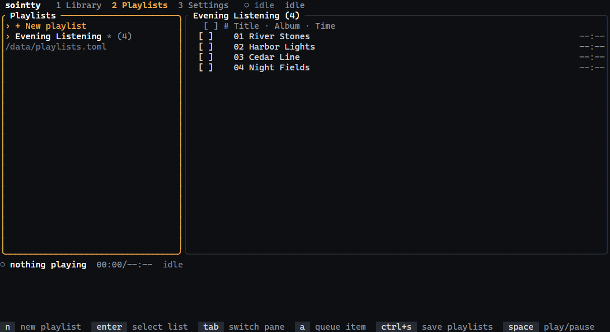
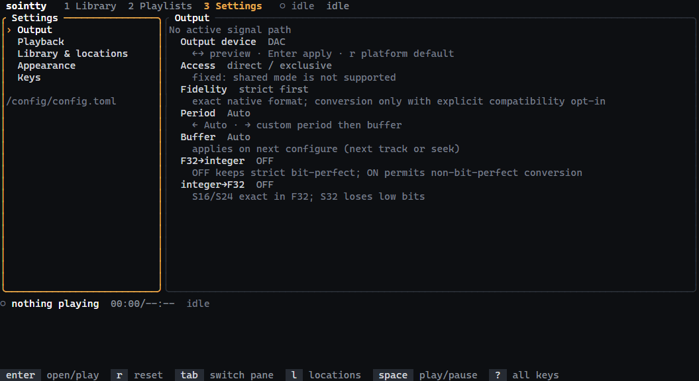

# Sointty

A terminal music player with a bit-perfect direct/exclusive output path by
default. An explicit `--shared` or TUI `g` opt-in uses the OS/system mixer:
it may resample, remix or process PCM, and is never bit-perfect. There is
no automatic fallback between access modes.

[](LICENSE-MIT)
[](https://blog.rust-lang.org/releases/)
[](#platforms)

Current build: **0.2.0** (see [CHANGELOG.md](CHANGELOG.md)). Verified on
Windows and macOS with an iFi ZEN DAC V2; the Linux backend is implemented
and unit tested, hardware testing pending.



## Try it

```sh
# Linux: ALSA headers required; libopus for the default Opus support
sudo apt install libasound2-dev libopus-dev
cargo build --release

# Windows / macOS: no system audio dependencies
cargo build --release
```

```sh
sointty --list-devices                 # list output endpoints
sointty /path/to/album/                # play files or folders
sointty playlist.m3u                   # playlists expand into tracks
sointty                                # no arguments: open the Library browser
sointty --exclusive /path/to/track.wav  # direct/exclusive (the default)
sointty --shared /path/to/track.wav     # OS mixer, not bit-perfect
```

With no arguments, sointty opens the Library screen where you last left it
(first launch: your home folder). A key guide stays visible at the bottom and
changes with the focused pane. Press `?` for the full key list or `q` to quit
immediately; if playlists have unsaved edits, quit asks whether to save first.
While typing in an input prompt, `q` is text; use `Ctrl+Q` to quit
immediately.

## The three screens

Press `1`, `2`, or `3` to switch screens (`b` and `m` also open Library and
Settings).

**1: Library.** Browse files on the left, see the upcoming queue in the
middle, and watch the Now playing panel on the right, which shows the format
as negotiated with the device. `a` queues the selected file or folder, `A`
queues the whole album, and `/` searches by typing.

**2: Playlists.** Manage named playlists stored on disk: `n` creates a list,
`space`/`v` select rows or a range, `Q` queues the selection, `m` moves it,
`d` removes it, `r` renames the list, and `Ctrl+S` saves all changes. Adding
tracks to a playlist never touches the playback queue.



**3: Settings.** Pick the output device, toggle direct/shared access, adjust
buffer timing, and toggle the conversion opt-ins. Press `d` from anywhere to
jump to Output settings, or `g` in Normal mode to toggle access immediately.



The screenshots are illustrative demo views rendered from the current UI with
throwaway demo files, not recordings of real libraries or hardware playback.

## Everyday keys

| Key | Action |
|---|---|
| `1` / `2` / `3` | Library / Playlists / Settings screen |
| `space` | play / pause |
| `s` / `n` | stop / next track |
| `←` / `→` | seek back / forward 10 s |
| `↑` / `↓` (`k` / `j`) | move the selection |
| `Tab` | switch pane |
| `Enter` | open a folder or play a track |
| `a` / `A` | queue the selection / queue the whole album |
| `/` | search: type to filter, `Enter` plays, `a` queues |
| `?` | full key list |
| `q` | quit immediately from any non-input pane |
| `Ctrl+Q` | quit immediately, including while typing in a prompt |

## Behavior

- In the default direct/exclusive mode, if the output device can't take the
  stream exactly as decoded, playback fails with a typed error instead of a
  silent conversion. Two separate opt-ins relax this: `--allow-float-to-int`
  (TUI `c`) enables F32→integer conversion for float-decoding formats on
  integer-only devices, and `--allow-int-to-float` (TUI `i`) enables
  integer→F32 conversion on float-only endpoints such as the macOS internal
  speakers (S16/S24 convert exactly; S32 loses its low 8 bits). Converted
  output is labeled `converted` in the Now playing panel.
- `--shared` (TUI `g`, persisted as `shared_playback = true`) sends PCM through
  the selected endpoint's OS mixer on Windows/macOS, or the system-configured
  ALSA `default` PCM on Linux. The OS may convert, resample, remix or process
  it; the Now playing badge says `shared` even when the submitted client bytes
  were unchanged. App-side F32/integer conversion, when used, is still named
  in the status line. Another application can play on the same route only
  when that endpoint and the OS mixer configuration support concurrency.
  An absent/busy shared route reports an error; it never falls back to Direct.
- Toggling access during playback stops the old backend and resumes the same
  track near its consumed source frame. The track ID, CUE bounds and upcoming
  queue survive, but the restart is not seamless. If reopening fails, the
  current entry returns to the queue front for a later Play in the requested
  mode; no old-mode fallback occurs.
- On macOS Direct, hog mode is paired with Core Audio Integer Mode:
  non-mixable integer stream formats are selected for both hardware and
  IOProc when the driver offers them. Capable USB DACs then receive exact
  integer samples with no conversion anywhere. Shared uses a separate AUHAL
  output unit and never changes the device's global nominal/physical/virtual
  formats.
- The reported output format describes the submitted client bytes. Shared
  mode does not claim the physical DAC format or a bit-perfect path.
- Tracks with an identical stream specification play gaplessly through one
  open device.
- File reads go through a bounded read-ahead worker, so slow or mounted drives
  stall gracefully and Stop/Skip/Seek stay responsive. Stalls and underruns
  are reported, not hidden.
- Local files only; remote URLs are rejected.

## More keys

Beyond the everyday keys above:

| Key | Action |
|---|---|
| `Backspace` | browser directory up (shows drives at a root) |
| `Tab` in search | cycle the search scope |
| `p` | add the selected track(s) to a playlist |
| `l` | locations: drives and network shares (map/mount via the OS) |
| `x` | actions overlay for the current pane |
| `r` | toggle random play for the live queue; the current song and preopened next song stay in place |
| `d` | jump to the output device setting |
| `g` | toggle shared OS-mixer playback / direct exclusive playback (off by default) |
| `c` | allow F32→integer conversion (off by default) |
| `i` | allow integer→F32 conversion for float-only devices (off by default) |
| `Esc` | close the current overlay or step back; quit from the Library home |

In search, `p` adds to a playlist and `o` opens the containing folder.
`Ctrl+Space` acts as play/pause inside editable lists, where `space` selects.

Queue pane: `d` removes the selected entry, `m` moves it (`↑`/`↓` pick the
gap, `Enter` drops), `Enter` jumps playback to it.

Playback shows elapsed/total time and a text progress bar. When the decoder
cannot report a reliable length, the total reads `--:--` and the bar remains
empty instead of estimating from file size.

## Fidelity rules

- In default Direct mode, PCM passes through unchanged. The only permitted
  transforms are lossless: channel interleaving, byte-order packing, and
  widening into a larger container with zeroed low bits (e.g. 24-bit samples
  in a 32-bit slot).
- Direct mode confirms rate, channel mask, packing, and valid bits with the
  device at initialization; mismatches raise `UnsupportedFormat`.
- Shared mode is an explicit, labeled opt-in to OS-managed PCM conversion,
  resampling, mixing and volume processing. It is never labeled bit-perfect,
  even if no app-side packer converts the submitted client format.
- F32→integer conversion, when enabled, is round-to-nearest-even with clipping
  and no dither, and runs on the decoder thread, not the render thread.
- Integer→F32 conversion, when enabled (or authorized by shared mode), divides
  by the full-scale integer range with no dither and likewise runs on the
  decoder thread. S16 and S24 values land exactly in the F32 mantissa; S32
  rounds to 24-bit precision.
- DSD is a separate stream type: native DSD or DoP on direct ALSA, never
  converted to PCM. Shared PCM explicitly rejects DSD/DoP.
- No `cpal`. Direct ALSA uses only explicit `hw:` endpoints (never `plug`,
  `plughw` or `default`); shared ALSA uses only the configured `default` PCM,
  never a hidden `dmix`/`plug`/other fallback.

## Formats

| Source | Formats | Notes |
|---|---|---|
| Symphonia (built in) | FLAC, ALAC, WAV/AIFF, MP3, AAC-LC, Vorbis | always available |
| Ogg Opus | `.opus` | default on Linux, `--features opus` elsewhere |
| FFmpeg (opt-in) | APE, WavPack, TAK, Musepack, DSF/DFF | `--features ffmpeg-lgpl`, needs system FFmpeg 9 |

Playlists: M3U/M3U8 (read+write), PLS, XSPF, single-image CUE with gapless
adjacent ranges.

## Platforms

| OS | Backend | Status |
|---|---|---|
| Linux | ALSA `hw:` Direct (native DSD/DoP); configured `default` PCM Shared | implemented; native hardware/concurrency verification pending |
| Windows | WASAPI exclusive Direct; WASAPI shared audio engine | Direct tested on an iFi ZEN DAC V2; Shared native concurrency verification pending |
| macOS | Core Audio HAL hog-mode Direct; separate AUHAL Shared | Direct tested on an iFi ZEN DAC V2; Shared native hardware verification pending |

### Tested devices

| Device | OS | Verified path |
|---|---|---|
| iFi ZEN DAC V2 | macOS | 192 kHz S24 FLAC, bit-perfect via Core Audio Integer Mode (non-mixable integer formats, hog mode) |
| iFi ZEN DAC V2 | Windows | WASAPI exclusive, integer path |

## Configuration

Settings live in `<config dir>/sointty/config.toml`
(`%APPDATA%\sointty\sointty\config\config.toml` on Windows,
`~/.config/sointty/config.toml` on Linux). Command-line flags override the
file. Named playlists live in `<data dir>/sointty/playlists.toml`; adding
tracks never touches the playback queue.

Buffer timing (period/buffer frames) is adjustable on the Settings screen
under Output; Auto derives timing from each track's sample rate.

`shared_playback = true` is the persisted, off-by-default OS-mixer opt-in.
`--shared` and `--exclusive` override it for one run. In the TUI, `g` and
Settings → Output → Access save the choice before switching; a failed save
leaves playback unchanged. On Linux the device picker selects a `hw:` endpoint
for Direct only; Shared always follows the system-configured ALSA `default`
route. That route must be mixer-backed for concurrent playback. A direct-only
`default` cannot offer concurrency, and Sointty does not retarget it.

Random play shuffles only upcoming queue entries, not saved playlists. Turning
it off keeps the current queue order and appends future songs in order. The
same toggle is `r` and under Settings → Playback.

## Building

MSRV is Rust 1.98.1 (edition 2024). Optional features on the app crate:

- `library-index`: opt-in SQLite index of the music collection. Off by default;
  filesystem browsing never touches a database.
- `ffmpeg-lgpl`: extra formats via a system FFmpeg 9 (LGPL builds only). Set
  `FFMPEG_DIR` (and `LIBCLANG_PATH` for bindgen) if discovery fails.

```sh
cargo build --release --features library-index
cargo build --release --features ffmpeg-lgpl
cargo test --workspace
```

## Repository layout

```
crates/
  core              shared types and exact-packing rules
  source            read-ahead file access with stall recovery
  decode            Symphonia, Opus, and FFmpeg decoders; tag reading
  playlist          M3U/M3U8/PLS/XSPF/CUE
  library           optional SQLite index
  output-alsa       Linux ALSA backend
  output-wasapi     Windows WASAPI backend
  output-coreaudio  macOS Core Audio backend
  tui               terminal UI and file browser
  app               player engine and command line
docs/PLAN.md        design notes, milestones, acceptance criteria
```

## Contributing

Issues and pull requests are welcome. Any change to the audio signal must be
explicit, opt-in, and labeled in the UI.

## License

MIT or Apache-2.0, your choice: [LICENSE-MIT](LICENSE-MIT),
[LICENSE-APACHE](LICENSE-APACHE).

The optional `ffmpeg-lgpl` feature dynamically links FFmpeg (LGPL-2.1-or-later);
only distribute binaries built against LGPL FFmpeg builds.
